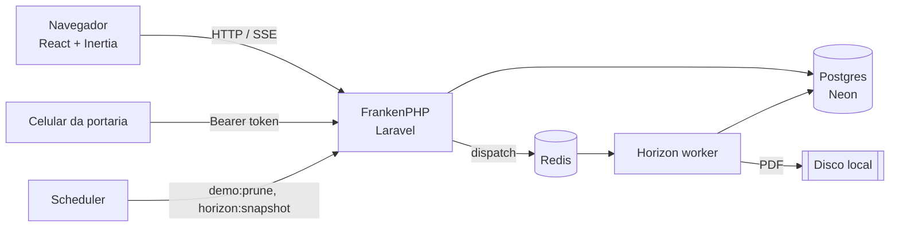

# EventPass

Inscrição, ingresso em PDF e portaria de eventos, do cadastro ao check-in.

[](https://github.com/lucasaccioly/eventpass/actions/workflows/tests.yml)


**Demo:** https://eventpass-gsos.onrender.com — clique em **Entrar como demo**. É um serviço gratuito que dorme quando ninguém usa, então a primeira visita pode levar uns 50 segundos.

## O que o projeto mostra

| Tema                                                                      | Onde está                                                                                                                                                                  |
| ------------------------------------------------------------------------- | -------------------------------------------------------------------------------------------------------------------------------------------------------------------------- |
| Fila Redis com Horizon (1 worker, 3 tentativas, backoff)                  | [`app/Jobs/GenerateTicketPdf.php`](app/Jobs/GenerateTicketPdf.php), [`config/horizon.php`](config/horizon.php)                                                             |
| PDF com QR code gerado em segundo plano (dompdf)                          | [`resources/views/pdf/ticket.blade.php`](resources/views/pdf/ticket.blade.php)                                                                                             |
| SSE: a página do ingresso e o painel atualizam sozinhos                   | [`app/Support/PollingStream.php`](app/Support/PollingStream.php), [`resources/js/hooks/use-sse.ts`](resources/js/hooks/use-sse.ts)                                         |
| Sanctum: cada celular da portaria tem um token que só vale para um evento | [`app/Actions/CreateGateDevice.php`](app/Actions/CreateGateDevice.php), [`app/Http/Controllers/Api/CheckInController.php`](app/Http/Controllers/Api/CheckInController.php) |
| Inscrição concorrente sem estourar as vagas (transação + `lockForUpdate`) | [`app/Actions/RegisterParticipant.php`](app/Actions/RegisterParticipant.php)                                                                                               |
| Testes com Pest (feature, unidade e arquitetura)                          | [`tests/`](tests)                                                                                                                                                          |
| Docker (FrankenPHP + Horizon + scheduler) e deploy na Render              | [`Dockerfile`](Dockerfile), [`docker/`](docker), [`render.yaml`](render.yaml)                                                                                              |

## Arquitetura



Web, Horizon e scheduler rodam no mesmo container, sob o supervisord.

## Fluxo

1. O organizador cria um evento e divulga a página pública (`/e/{slug}`).
2. O participante se inscreve sem conta. O ingresso abre em "Gerando…" e vira um botão de download quando o job termina, sem recarregar.
3. Na portaria, o celular abre um link com token (`/portaria#token=…`), lê o QR code com a câmera ou aceita o código digitado. Cada ingresso entra uma vez só.
4. O painel do organizador mostra inscritos, check-ins e as últimas entradas em tempo real.

## Decisões

- **Um container só.** Web, fila e scheduler no mesmo serviço gratuito. Em produção de verdade seriam serviços separados, mas aqui o custo zero vale mais.
- **SSE em janelas de 30 s.** Cada conexão consulta o banco a cada segundo, envia só quando algo muda e fecha em 30 s. O navegador reconecta sozinho e recebe um retrato novo, então nada se perde, e nenhuma thread do PHP fica presa para sempre.
- **Demo por visitante.** "Entrar como demo" cria uma conta e um evento preenchido só para quem clicou. Ninguém vê os dados de outro, e tudo é apagado em 24 h (`demo:prune`, de hora em hora).
- **Disco apagado não quebra nada.** O disco da Render é efêmero. Se o PDF sumiu, o download volta o ingresso para "Gerando…" e enfileira o job de novo.
- **Check-in atômico.** Um `UPDATE … WHERE checked_in_at IS NULL` decide quem entra. Duas leituras simultâneas do mesmo QR geram uma entrada e um "já usado".
- **Token fora do histórico.** O token da portaria vai no `#fragmento` da URL (não chega ao servidor nem aos logs), é guardado no `localStorage` e removido da barra de endereço.

## Rodando

Localmente, com SQLite e a fila no banco:

```bash
composer setup
composer dev
```

Abra http://localhost:8000. O `composer dev` sobe o servidor, o worker da fila e o Vite.

Com Docker Compose (Postgres, Redis e Horizon, como em produção):

```bash
APP_KEY=$(php artisan key:generate --show) docker compose up --build
```

## Testes

```bash
composer test
```

Roda Pint, PHPStan (nível 7) e a suíte do Pest. O CI roda também o lint e a checagem de tipos do front-end e o build da imagem Docker.

## Licença

[MIT](LICENSE)
